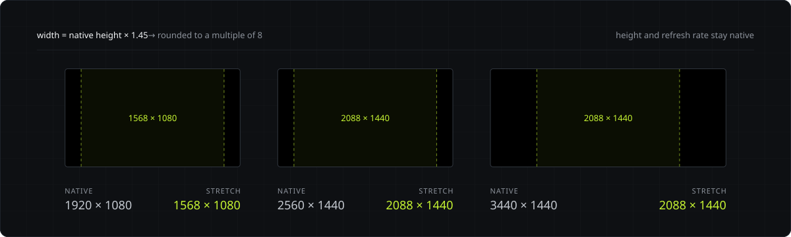

<div align="center">



<a href="https://github.com/veqzo/wide-peek/releases/latest"></a>&nbsp;
<a href="#quick-start"></a>

[How it works](#how-it-works) ·
[Commands](#commands) ·
[Safety](#safety-and-anti-cheat) ·
[Troubleshooting](docs/TROUBLESHOOTING.md)

</div>

widepeek is one small `widepeek.exe` for Windows. It switches your display to
a true stretched resolution, starts Valorant, and restores your display when
the game ends. No runtime, no background service, no GUI framework.

## Why widepeek?

Valorant normally shows a 4:3 or 5:4 resolution with black bars, even when the
GPU scaling is set to *Full-screen*. The usual workaround is a manual routine
before and after every session: disable the monitor in the Device Manager,
change the resolution, play, then undo all of it. widepeek does this routine
for you, and it never leaves your PC in a broken state.

| | Manual routine | widepeek |
|---|---|---|
| **Before each game** | Device Manager + resolution change | Click the shortcut |
| **After each game** | Undo everything by hand | Automatic |
| **Crash, power loss, kill** | Display stays stretched | Restored at the next logon |
| **Custom resolution** | Create by hand in the driver panel | Created by setup (NVIDIA, AMD) |
| **UAC prompts** | Every time | Once, at setup |

## Features

- **One click.** The shortcut *Valorant (widepeek)* stretches, starts the game
  and restores after it.
- **Always restores.** Normal exit, error, logoff, crash or power loss: the
  display comes back to native. See [Restore guarantees](#restore-guarantees).
- **Automatic custom resolution** on NVIDIA (NVAPI) and AMD (ADLX), with a
  15-second confirm dialog and safe CVT-RB timings.
- **Hands off the game.** No handle to the game process, no memory access,
  no injection. See [Safety](#safety-and-anti-cheat).
- **Tiny.** One static exe, about 1.5 MB of memory, close to zero CPU.
- **Multi-monitor aware.** All displays get their modes back after the game.
- **Updates in the app.** Optional daily check. widepeek asks, then installs
  the new release with one UAC prompt. See [Updates](#updates).

## Quick start

1. **Download** `widepeek.exe` from the [releases](../../releases).
   The releases are not signed (see [Unsigned releases](#unsigned-releases)),
   so SmartScreen or your antivirus can show a warning. Compare
   `(Get-FileHash .\widepeek.exe).Hash` with `widepeek.exe.sha256` of the
   release, then click *More info* > *Run anyway*.
2. **Run setup** once and follow the wizard:

   ```powershell
   .\widepeek.exe setup
   ```

3. **Set Valorant once** (Settings > Video > General):

   | Setting | Value |
   |---|---|
   | Display Mode | **Windowed Fullscreen** |
   | Monitor | The display that you chose in setup |
   | Resolution | The stretched mode, for example `2088 × 1440` |
   | Aspect Ratio Method | **Fill** |

4. **Check the GPU scaling.** On NVIDIA and AMD, setup sets it for you
   (NVIDIA: **Full-screen**, scaling on **GPU**. AMD: **GPU Scaling** on,
   **Scaling Mode** Full panel, **Integer Scaling** off). On Intel, setup
   shows the manual steps.
5. **Play** with the shortcut **Valorant (widepeek)** on the desktop or in the
   Start menu.

> [!TIP]
> Use **Windowed Fullscreen**, not Fullscreen. The desktop already runs in the
> stretched mode, so the picture is the same. Exclusive Fullscreen often moves
> the cursor away from the buttons in the menus.

Something does not look right? Read the
[troubleshooting guide](docs/TROUBLESHOOTING.md).

### Recommended resolution

widepeek suggests **width = native height × 1.45**, rounded to a multiple of 8.
The height and the refresh rate stay native. Use `widepeek setup --width <px>`
for another width.



<details>
<summary><b>What setup does</b></summary>

- Asks which display to stretch.
- Sets the GPU scaling first, because the AMD driver needs it for the
  stretched test. If setup fails later, the old setting comes back:
  - **NVIDIA:** automatic through NVAPI: *Full-screen*, scaling on the *GPU*.
    Setup shows a dialog and keeps the setting only when you click *Yes*.
    Without an answer within 15 seconds, the old setting comes back. If a
    driver update resets the setting, the next session sets it again.
    Uninstall restores the setting from before setup.
  - **AMD:** automatic through ADLX: *GPU Scaling* on, *Scaling Mode* Full
    panel, *Integer Scaling* off. The dialog, the session check and the
    uninstall restore work as on NVIDIA.
  - **Intel:** setup shows the manual steps.
- Creates the custom resolution:
  - **NVIDIA:** automatic through NVAPI. Setup tries the mode, shows a dialog,
    and saves the mode only when you click *Yes*. Without an answer within
    15 seconds, the old mode comes back. Setup rejects timings with a higher
    refresh rate or pixel clock than the native mode.
  - **AMD:** automatic through ADLX. The AMD driver saves a new mode at once,
    so setup tries it without a registry change and deletes it again when you
    do not click *Yes*. The same timing checks apply. If setup ends during the
    test (crash, closed window, power loss), the next setup or uninstall
    deletes the unconfirmed mode.
  - **Intel:** setup shows the manual steps for the driver panel, then checks
    that Windows lists the mode.
- Installs the exe to `C:\Program Files\widepeek\` and creates the scheduled
  tasks `\widepeek\MonitorOff`, `\widepeek\MonitorOn` and
  `\widepeek\RestoreAtLogon`. Only this step needs administrator rights, so
  you see one UAC prompt.
- Creates the shortcut **Valorant (widepeek)** on the desktop and in the Start
  menu.
- Asks if widepeek may check for updates once per day. The default is *No*.

</details>

## How it works

Valorant asks the monitor, through its EDID, which modes it supports, and it
keeps the native aspect ratio. True stretched removes that limit:

1. A custom resolution with a narrower width exists in the graphics driver.
2. The monitor devices are disabled in the Device Manager. Windows then uses
   the display without its EDID, and the game accepts the custom mode as a
   real desktop resolution.
3. The desktop is set to the custom mode before the game starts. The GPU
   stretches the picture to the full panel.

Setup does step 1 once. widepeek does steps 2 and 3 for each session and
undoes them when the game ends. It disables **all** monitor devices: with one
monitor still enabled, the game opens on that monitor.

<details>
<summary><b>The launcher step by step</b></summary>

1. If the last session did not end cleanly, restore it first.
2. Write a state file with the native mode, the modes of the other displays
   and the list of enabled monitor devices.
3. Disable all monitor devices (scheduled task with highest privileges).
4. Test the stretched mode with `CDS_TEST`, then apply it.
5. Start the Riot Client with `--launch-product=valorant --launch-patchline=live`.
6. Wait for `VALORANT-Win64-Shipping.exe` (process list every 1 s, timeout 5 min).
   If the Riot Client and `VALORANT.exe` end before the game starts, go to
   step 8 after about 10 s.
7. Wait for the game to end (process list every 5 s).
8. Enable the monitor devices, restore the native mode and the modes of the
   other displays, delete the state file.

widepeek and the Riot Client run **unelevated**. Only the monitor toggle runs
elevated, through the scheduled tasks.

</details>

## Commands

| Command | What it does |
|---|---|
| `widepeek` / `widepeek launch` | Stretch, start Valorant, wait for the game to end, restore (default) |
| `widepeek tray` | Stay in the tray, stretch when `VALORANT.exe` starts (optional) |
| `widepeek setup` | One-time setup. Options: `--width`, `--height`, `--hz`, `--display`, `--yes` |
| `widepeek restore` | Restore the native mode and enable the monitors. Safe at any time |
| `widepeek update` | Check for a new version now and offer to install it |
| `widepeek uninstall` | Restore, then remove tasks, shortcuts, autostart, files and config |

`monitor-off`, `monitor-on`, `install-system`, `uninstall-system` and
`install-update` are internal.

> [!NOTE]
> `widepeek.exe` is a GUI subsystem program, so `cmd` does not wait for it.
> Use `start /wait widepeek launch` in cmd, or
> `Start-Process widepeek -ArgumentList launch -Wait` in PowerShell.

<details>
<summary><b>Tray mode</b></summary>

`widepeek tray` stays in the notification area. It checks the process list
every 2 s and stretches when `VALORANT.exe` starts. The menu has a status line,
*Restore now*, *Check for updates* and *Quit*. Setup can add it to the
autostart (unelevated, `HKCU\...\Run`).

The launcher is the recommended way. The tray stretches only after
`VALORANT.exe` started, so the game can already read the native resolution.
Then you must restart the game once.

</details>

## Restore guarantees

Your PC must never stay in the stretched mode or with a disabled monitor.

| Event | Restore path |
|---|---|
| Game ends normally | Launcher restores within about 5 s |
| Error or panic in widepeek | Drop guard restores during unwind |
| Console closed, logoff, shutdown | Console handler and `WM_ENDSESSION` restore |
| widepeek killed, PC crash, power loss | `RestoreAtLogon` restores at the next logon; the next start restores first |
| Anything else | `widepeek restore`, or the tray item *Restore now* |

After a reboot, the PC can start in the stretched mode for about 5 seconds
until `RestoreAtLogon` runs, because Windows stores the display mode in the
registry. `restore` also works without a config or a state file: then it
enables all disabled monitor devices and sets each display to its best mode.
Only one session runs at a time (named mutexes).

## Updates

The automatic check is opt-in: setup asks once, and if you say *Yes*, widepeek
checks at most once per day. You can always check by hand with
`widepeek update` or *Check for updates* in the tray. widepeek shows the new
version and its release notes, and installs only after you click *Yes* and
confirm one UAC prompt. It never updates while Valorant or a stretch session
runs.

The check reads `releases/latest` of this repository from the GitHub API over
HTTPS and sends no data about you or your PC. Like for any web page, GitHub
sees your IP address.

<details>
<summary><b>What widepeek checks before it installs</b></summary>

1. The release is not a draft or a pre-release, and its version is higher
   than the installed version.
2. The download URLs point to this repository on GitHub. All requests and
   redirects go only to GitHub hosts over HTTPS. The exe has at most 20 MB.
3. The SHA-256 of the exe matches `widepeek.exe.sha256` of the release.
4. If the installed exe is signed, the new exe must have a valid signature
   with the same certificate subject. An unsigned exe cannot replace a signed
   one. The releases are not signed at the moment, so the SHA-256 check is
   the main check.
5. The elevated step runs the **installed** exe from
   `C:\Program Files\widepeek`, not the download. It gets only the path, the
   version and your account from the unelevated caller. It refuses a version
   that is not newer than the installed one, so no downgrade is possible. It
   reads the release and its SHA-256 file from GitHub itself.
6. The elevated step reads the download once from your local disk and writes
   it to a staging file in `C:\Program Files\widepeek`. It checks the hash,
   the exe header and the signature of that copy. Then it swaps the files.
   If the swap fails, the old exe comes back. Then the new exe updates the
   scheduled tasks.

</details>

## Safety and anti-cheat

> [!IMPORTANT]
> widepeek **never touches the game process**. It opens no handle to it, it
> does not read, write or inject, and it sends no input. It only reads the
> system process list (Toolhelp), like the Task Manager. Everything else is
> the normal Windows display API and the Device Manager API, used before the
> game starts and after it ended. widepeek never edits `GameUserSettings.ini`.

While the monitors are disabled, Windows sees the display without its EDID:
G-Sync / FreeSync are off, ICC color profiles and HDR are not available, and
the monitor shows a generic name. Everything comes back when widepeek restores.

<details>
<summary><b>Security details</b></summary>

- The elevated steps (`install-system`, `uninstall-system`) only touch
  `C:\Program Files\widepeek` and the `\widepeek` task folder. They never write
  the config, the state file or the log in your user profile.
- The elevated `monitor-off` and `monitor-on` read no file. They disable all
  enabled or enable all disabled Monitor-class devices. So `monitor-on` also
  enables a monitor device that you disabled yourself.
- Setup copies the running image, not the file at its path, so a file that
  another process puts at that path during setup is not installed.
- The administrator prompt must use the same Windows account as the wizard.
- An update is installed only after the checks in [Updates](#updates). The
  elevated update step takes only a path, a version and an account SID from
  the unelevated caller. It gets the expected SHA-256 from GitHub itself and
  checks a copy in the program folder, not the file in your profile.
- The exe links the C runtime statically and loads DLLs only from `System32`,
  so a planted DLL next to the download is not loaded.

</details>

<details>
<summary><b>Measured overhead</b> (release build, Windows 11, 12 logical cores, about 210 processes)</summary>

| Item | Result |
|---|---|
| One process-list lookup (Toolhelp) | 2.2 ms CPU |
| Tray, idle, 120 s | 0.01–0.02 % of total CPU (0.17–0.25 % of one core) |
| Tray memory | 1.5 MB private, 0.6 MB working set |
| Launcher | One lookup per second before the game starts (about 0.2 % of one core), one every 5 s while it runs (about 0.04 %) |

The CPU time of Windows has a granularity of 15.6 ms, so the tray numbers are
noisy.

**Why Toolhelp and not WMI:** `Win32_ProcessStartTrace` needs administrator
rights, and the tray runs unelevated. `__InstanceCreationEvent WITHIN 2` polls
the process list inside the WMI service, so it does the same work in another
process and adds a dependency. Toolhelp gives the same result with fewer parts.

</details>

<details>
<summary><b>Files</b></summary>

| Path | Content |
|---|---|
| `C:\Program Files\widepeek\widepeek.exe` | Installed exe |
| `%AppData%\widepeek\config.toml` | Configuration |
| `%LocalAppData%\widepeek\widepeek.log` | Log (rotates at about 1 MB) |
| `%LocalAppData%\widepeek\state.json` | Only while a session runs |
| `%LocalAppData%\widepeek\update.json` | Time of the last update check |
| `%LocalAppData%\widepeek\update\` | Only while an update installs |

The config stores the GDI name of the display (`display_name`) and the device
path of its monitor (`monitor_path`). If Windows gives the display another
name, for example after a driver update, widepeek finds it again through the
monitor path.

The config has a `riot_client_path` option. If it is set and the file exists,
widepeek uses it. Otherwise it reads `RiotClientInstalls.json`, then it uses
the default install path.

</details>

## Known limitations

- Only Valorant.
- Automatic custom resolution only on NVIDIA and AMD. Intel needs one manual
  step in the driver panel.
- AMD: Eyefinity and duplicated displays are not supported. Setup then shows
  the manual steps.
- One display is stretched. All monitor devices are disabled during the game,
  so the other displays lose their EDID modes too. widepeek sets their modes
  back after the game.

## Unsigned releases

The release exe has no code signing certificate, so SmartScreen can show
*Windows protected your PC* (click *More info* > *Run anyway*), and some
antivirus programs can flag the exe. Most of the time this is a false
positive: unsigned tools that change display settings and ask for admin rights
often get flagged. To check the exe yourself:

1. Compare `(Get-FileHash .\widepeek.exe).Hash` with `widepeek.exe.sha256`
   of the release. CI builds the exe from the tag in this repository and
   creates the SHA-256 file.
2. Upload the exe to [VirusTotal](https://www.virustotal.com) or search for
   its SHA-256 there.
3. Or build it from source with `cargo build --release`. The exe is at
   `target\release\widepeek.exe`.

## Privacy and disclaimer

This program will not transfer any information to other networked systems
unless specifically requested by the user or the person installing or
operating it.

widepeek is not made by, endorsed by or associated with Riot Games. Valorant
and Riot Client are trademarks of Riot Games, Inc. widepeek changes display
settings and disables devices in the Device Manager. Use it at your own risk.
The authors are not responsible for bans, display problems or other damage.
Riot can change what is allowed at any time.

---

<div align="center">
<sub><b>widepeek</b> · <a href="LICENSE">MIT license</a> · Not affiliated with Riot Games. Valorant is a trademark of Riot Games.</sub>
</div>
